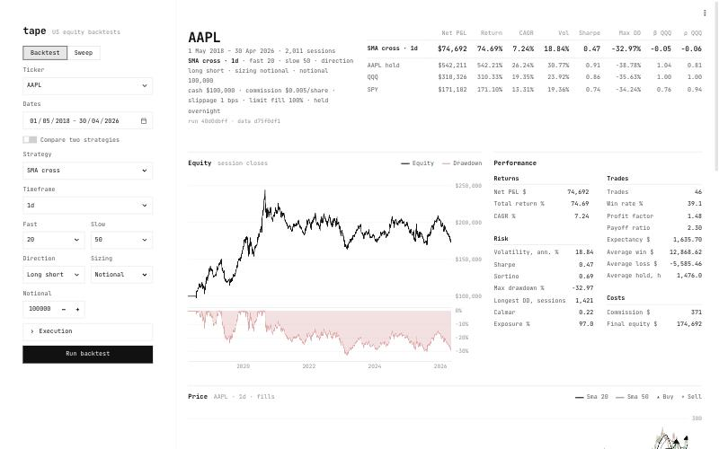
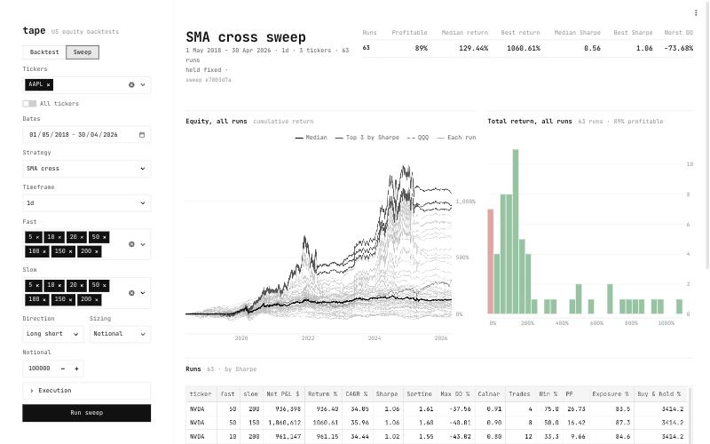
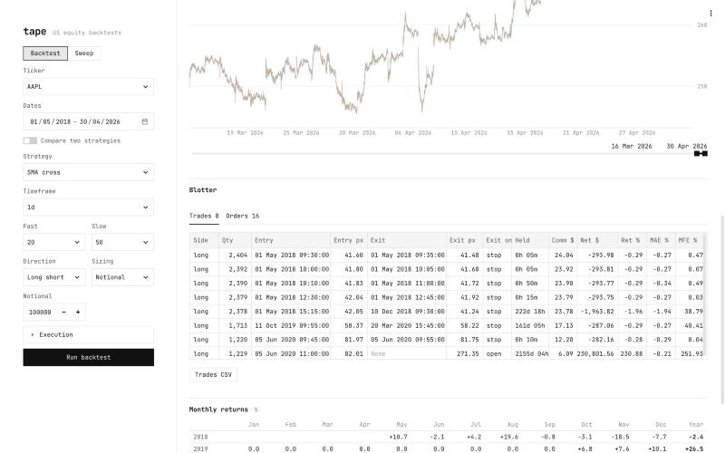

# tape

Bar-level US equity backtesting service.

Single run: benchmark comparison, equity and drawdown, performance.



Parameter sweep across tickers: every run's equity, return distribution, ranked runs.



Price with fills, trade blotter and monthly returns.



## Setup

```bash
uv sync
uv run tape env
```

## Checks

```bash
uv run ruff format --check && uv run ruff check && uv run mypy src tests && uv run pytest
```

## Run

```bash
uv run tape catalog build
uv run tape serve api
uv run tape serve ui
```

The API and UI bind to `127.0.0.1`. From a laptop, reach a server's UI through a tunnel:

```bash
ssh -N -L 8501:127.0.0.1:8501 <ssh-host>
```

## Configuration

| Variable | Default |
|---|---|
| `TAPE_HOME` | `~/tape` |
| `TAPE_SOURCE_DIR` | `$TAPE_HOME/source` |
| `TAPE_STORE_DIR` | `$TAPE_HOME/store` |
| `TAPE_RESULTS_DIR` | `$TAPE_HOME/results` |
| `TAPE_LOG_LEVEL` | `INFO` (`DEBUG`, `INFO`, `WARN`, `ERROR`) |

## Deploy

```bash
deploy/sync.sh <ssh-host>
```

Copies the working tree to `~/tape/app` on the host, installs the locked environment, runs `tape env` and restarts the services if they are installed.

Once per host, on the host:

```bash
sudo ~/tape/app/deploy/install.sh <public-hostname>
```

Installs the `tape-api` and `tape-ui` systemd services and nginx: HTTPS, HTTP redirected to HTTPS, basic-auth login in front of the UI (`--open` turns it off), API reachable only from the host. The certificate is self-signed until a domain points at the host. The user file starts empty; add each person with:

```bash
sudo htpasswd -B /etc/nginx/tape/htpasswd <name>
```
