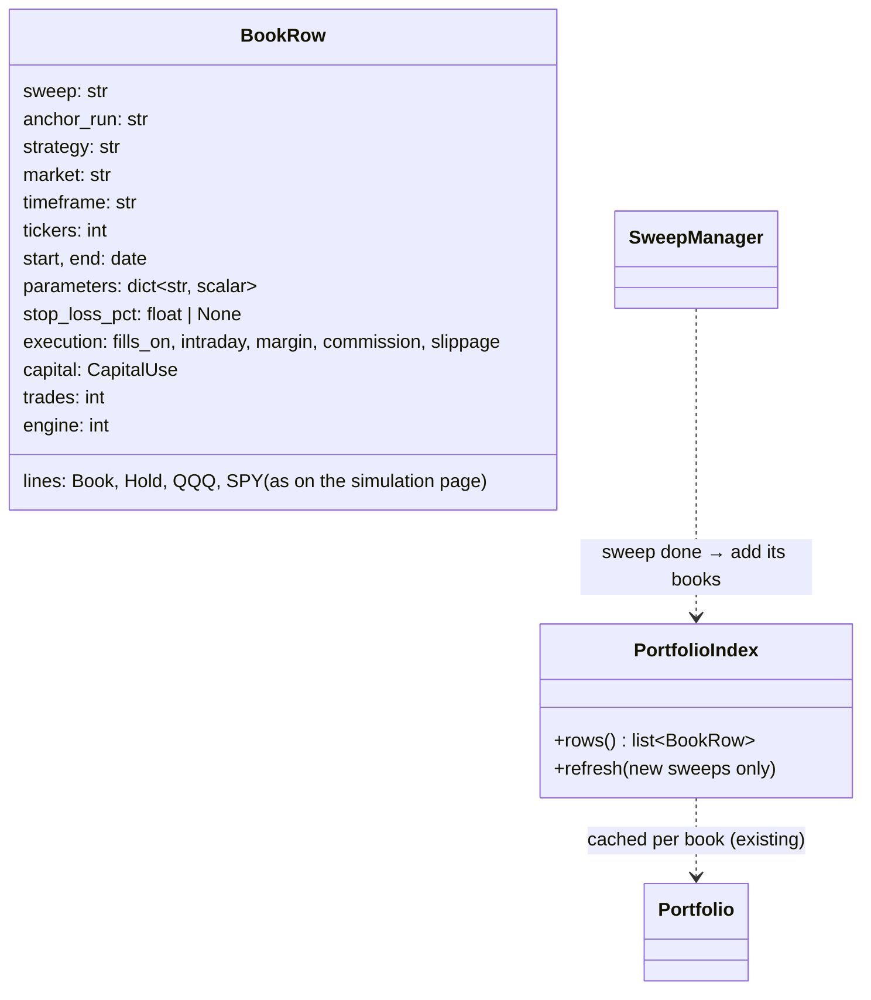

# Portfolios screen: every completed simulation's books in one comparable table

Status: built 2026-11-24. Scope changed on review: the table covers the 10 most recent simulations (`RECENT`),
not every stored one; older simulations drop out as new ones finish.

## 0. Baseline (measured 2026-11-24 on EC2)

89 completed simulations, 566 books, 19,070 runs: SMA cross 406 books, SMA Breakout 115, High-Breakout 41,
Low-Breakdown 4. A book is one simulation x one parameter set (all its tickers, one sleeve each). The simulation
page already computes one book's portfolio (`GET /sweeps/{key}/portfolio?run=`, cached per book, about 12 s the
first time for 477 runs, mostly reading fills for capital use).

## 1. Requirements

- R1. A third page, next to Single line and Simulation, shall list every book of every completed simulation, one
  row per book, with the same figures as the simulation header.
- R2. Every row shall have the same columns whatever the strategy. Strategy parameters shall not need new code or
  a schema change when a strategy is added.
- R3. Rows shall be filterable by strategy, market, timeframe, period, stop loss, parameters and execution
  settings, and sortable by any figure.
- R4. A row shall open its simulation with the book pinned (the existing simulation link format).
- R5. Opening the page shall not compute anything heavy; figures come from a precomputed table.
- R6. Shared links, run keys and stored results stay untouched (new endpoint and page only).

## 2. Columns

Fixed columns (every strategy, every future strategy):

| Group | Columns |
|---|---|
| Identity | Strategy · Market · Timeframe · Tickers · Start · End · Years · Parameters (text, e.g. `fast 5 · slow 10`) · Stop loss % |
| Execution | Fills on (bar / minute) · Intraday · Margin (none / 30x) · Costs (commission, slippage) |
| Book | Net P&L · Total return · CAGR · Ann. vol · Ann. Sharpe · Max DD · Max DD from capital · β QQQ · ρ QQQ · No of trades |
| Capital | Initial capital · Final capital · Capital used avg · Capital used max · Overnight avg |
| Against | Hold return · Book − Hold · QQQ return (same dates) · Book − QQQ |
| Links | Open (simulation pinned to the book) · Simulation id · Engine (current / outdated) |

Parameters, future-proof (R2): stored once per book as a typed map `{name: value}`. The table always shows the
`Parameters` text column. When the filter narrows to one strategy, that strategy's parameters also appear as
their own columns (`Fast`, `Slow`, or `Trend`, `Window`, …), taken from the rows themselves, so a new strategy's
parameters appear without any change.

## 3. Data

- One parquet table, `results/portfolios.parquet`, one row per book, explicit Arrow schema; parameters stored as
  a JSON string column plus the text column (Parquet has no open map of mixed scalars that DuckDB and pandas both
  read the same way).
- Built from the existing per-book cache: a missing book is computed once (same code as the simulation page).
- First build: about 19,070 runs of fills at ~25 ms each ≈ 8 minutes, in a background thread at low priority;
  the page shows the rows ready so far and says how many are pending.
- After that, a finished simulation adds its books when it completes; the page never waits on computation.
- `GET /portfolios` returns the table (parquet, like `/sweeps/{key}/summary`); `GET /portfolios/status` returns
  built / pending counts.

## 4. Screen

- Navigation: Single line · Simulation · **Portfolios** (name to approve).
- Sidebar filters (same style as the other pages): Market, Strategy (multi), Timeframe (multi), Stop loss (multi),
  Period (from / to, overlap), Fills on, Margin, Engine (current only, default on), text search on parameters.
- Main: one table, sorted by Sharpe by default, frozen left columns Strategy / Timeframe / Parameters, column
  groups as in section 2, numbers right-aligned, sign colours as the rest of the lab; row click opens the book.
- Above the table: count of books shown / total, and the pending count while the first build runs.

## 5. Edge cases

| Case | Handling |
|---|---|
| a simulation whose parameters repeat a ticker (no single book) | skipped, listed in status as not a book |
| simulation run on an older engine | shown, `Engine: outdated`; hidden by the default filter |
| simulation cut short / failed | not listed (only complete summaries count, same rule as the cut-short fix) |
| margin book | shown with Margin 30x; figures are the same book figures |
| same parameters run twice with different execution (bar vs minute fills, 0.25 vs 0.5 % stop) | separate rows, told apart by the execution columns |
| FX book, QQQ/SPY data ends earlier | QQQ return over the overlap, with the end date in the column tooltip and a flag column |
| book with zero trades | row shown, ratios that are undefined show `–` |
| a run file missing or unreadable, or any error in one book | that book is skipped with `Type: message` in the status file; the rest are built |
| a run with no fills, no bars or no sessions | capital used and overnight are 0 for that run (measured on the margin High-Breakout 1h book) |
| a build that fails outright | not retried until the set of recent simulations changes (no retry loop) |
| new strategy | its parameters appear in `Parameters` and as columns when filtered to it; nothing else changes |
| very long parameter text | truncated in the cell, full text in the tooltip |
| 566 rows now, thousands later | the table pages (50 rows); filters run on the loaded table |

## 6. Tests (pass criteria fixed now)

| Id | Test | Pass |
|---|---|---|
| T1 | index rows equal the per-book portfolio for every book of the test simulations | equal |
| T2 | a new simulation adds its books on completion; a cut-short one adds none | as stated |
| T3 | parameters of two strategies in one table: text column always, own columns only when filtered to one | as stated |
| T4 | schema round trip, empty index | valid |
| T5 | bad book (repeated ticker) and missing run file are reported, not fatal | reported |
| A1 | EC2: all 566 books built; spot check 5 rows against the simulation page | equal |
| A2 | 6,225-link snapshot before and after deploy | 0 differences |
