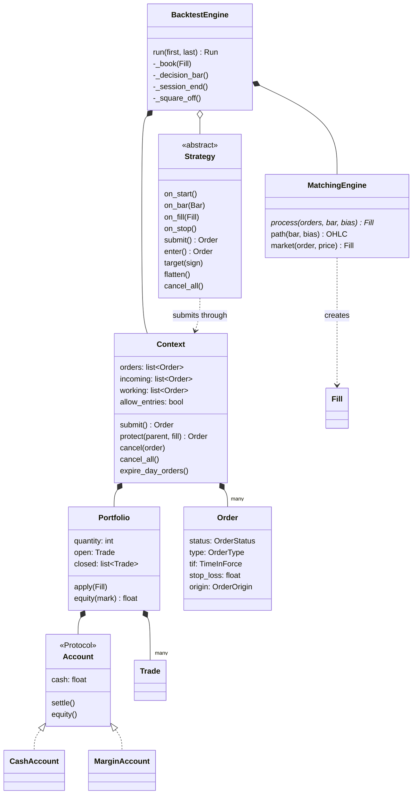
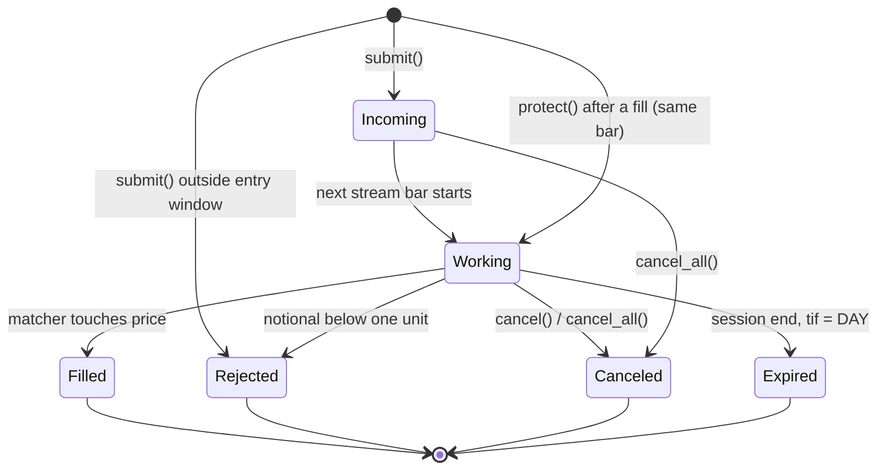
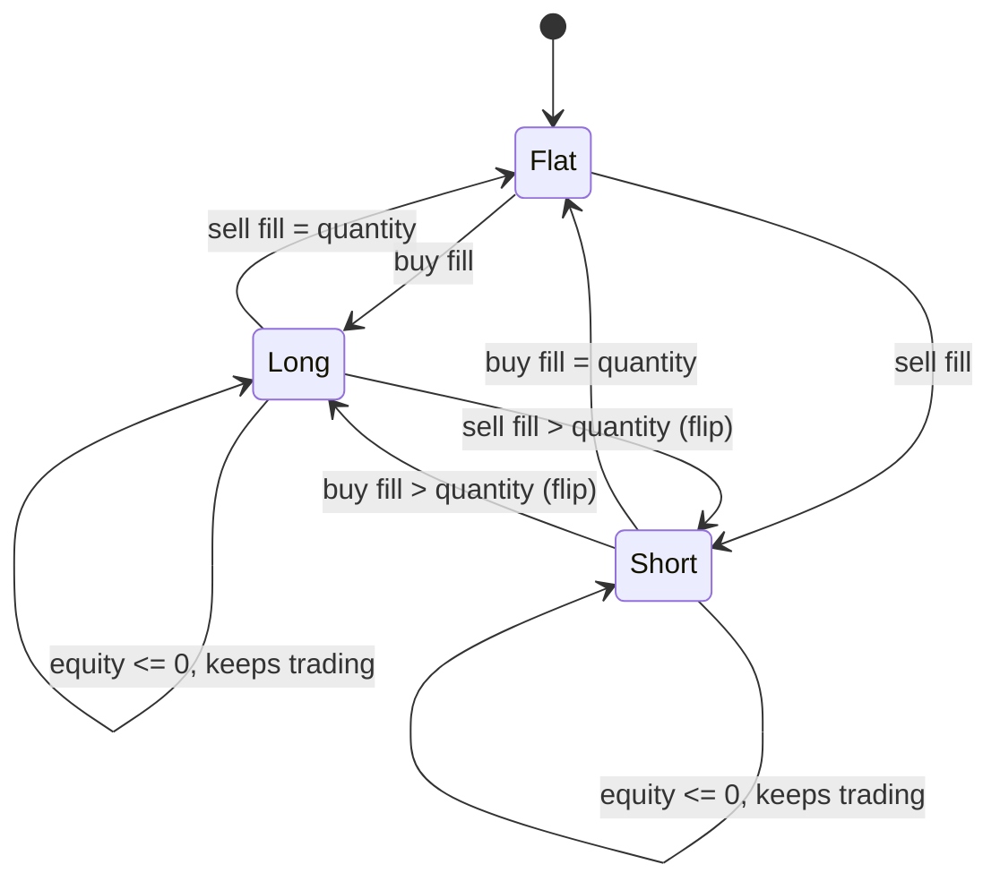
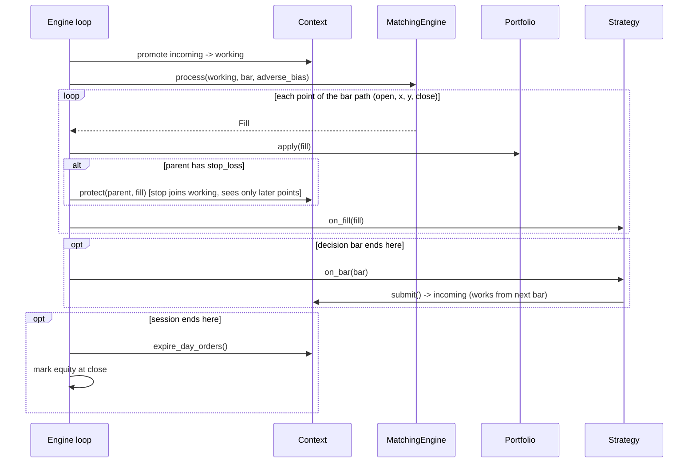

# Engine design review: UML

Diagrams drawn from the code as it stands (`src/tape/engine`, `src/tape/strategies`), then each state, transition and
alternate path checked against it. Gaps are listed at the end with whether they move today's numbers.

## 1. Class diagram

Note the arrows the diagram does **not** have: no link from a protective stop `Order` to the parent order or the
`Trade` it protects, and no callback from `Context` to `Strategy` except `on_fill`.

## 2. State diagram: Order

Book check, every transition maps to a method: it does. But only **one** of the four terminal states (Filled) is
reported back to the strategy (`on_fill`). Rejected, Canceled and Expired are silent.

## 3. State diagram: Position and account

The last two self-transitions are what the code does today. A real account has a `Liquidated` state that is
missing here; no invariant on `Portfolio` or `Account` forbids equity at or below zero.

## 4. Sequence diagram: one stream bar

This is the diagram that would have shown today's bug before it shipped: a protective stop created mid-path only
sees the points after the entry, so the order of `x` and `y` decides whether a same-bar stop-out happens.

## 5. Use case: run a breakout backtest, with alternate sequences

| # | Sequence | Handled? |
|---|---|---|
| Main | Decision bar sets level -> price crosses -> buy -> later stop or exit | Yes |
| A1 | Entry and stop both reachable in one bar | Yes since today (`adverse_bias`, minute fills) |
| A2 | Price gaps through the entry or the stop at the open | Yes, fills at the open |
| A3 | Weekend or holiday gap (FX) | Yes, same gap rule |
| A4 | Position closed by a signal while its stop is still working | Only if the strategy remembers `cancel_all()` |
| A5 | Entry order rejected or expired before filling | Strategy is not told |
| A6 | Equity falls to zero | Not handled |
| A7 | Order larger than the market can absorb | Not modelled; all-or-nothing fills at any size |

## 6. Gaps found

| # | Gap | Where | Affects today's numbers? |
|---|---|---|---|
| G1 | **No zero-equity rule.** Equity can go below zero and the pair keeps trading at full notional. Sizing uses the fixed config notional, not current equity, so leverage grows as equity shrinks. Same for `CashAccount` (cash can go negative: no buying-power check). | `Portfolio`, `Account`, `Strategy.opening()` | **Yes**: books 27-29, 34-36, 40-41 |
| G2 | **Orphan protective stop.** A stop created by `protect()` is not linked to its parent or trade. If the position is closed by any other order and the strategy did not call `cancel_all()`, the stop stays working (GTC) and, when hit, opens a reverse position, even in a long-only strategy. | `Context.protect`, `_book` | No: `SmaBreakout` always cancels before `flatten`; `Breakout` exits only by its stop. Latent for any new strategy. |
| G3 | **Silent order outcomes.** Strategies hear only `on_fill`. A Rejected, Canceled or Expired entry leaves state such as `SmaBreakout.pending` pointing at a dead order, so the strategy waits forever. | `Strategy` callbacks | No for current FX books (no rejections occur). Latent. |
| G4 | **Unprotected position after `cancel_all()`.** `cancel_all()` also cancels the protective stop; a strategy that cancels without flattening holds an unprotected position. | `Context.cancel_all` | No today. Latent. |
| G5 | **Fill timestamps with `fill_on: bar`.** A fill is stamped with the start of its bar, up to a full bar earlier than the real touch (3h55 on 4h). Prices are right; trade times and durations are not. | `MatchingEngine.process` time argument | Trade durations and times on bar-fill runs only. |
| G6 | **Unstated assumptions.** All-or-nothing fills at any size, no costs (intentional for phase 1), stops fill at the level unless gapped. Correct as choices, but not written down anywhere a reader sees. | Report / spec | No; documentation. |

## 7. Requirements these imply (must/shall)

- R1 The simulator **shall** stop a pair from opening or adding to positions when its equity is at or below zero. (G1)
- R2 Closing a position **shall** cancel every protective stop attached to it. (G2, G4)
- R3 The strategy **shall** be notified of every terminal order outcome: filled, rejected, canceled, expired. (G3)
- R4 Reported fill times **shall** be the time the price was reached, to the resolution of the fill data. (G5)
- R5 The report **shall** state its execution assumptions: costs, fill size, stop fill rule. (G6)
